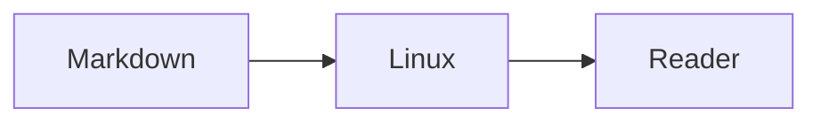

# Personal / Space

A personal website whose interface is an actual **ncurses 6.5 C application**, running as PID 1 in **Linux 6.6.90**, inside the **v86 WebAssembly virtual machine**. xterm.js renders the guest's serial terminal. Page navigation and all terminal content are implemented in the Linux program, not emulated in HTML.

Notes and Projects are compiled from Markdown. The bundled sample demonstrates prose, Mermaid diagrams, and LaTeX; Work includes a résumé compiled from LaTeX, and Shell runs BusyBox ash.

## Build and preview

The Makefile lives at the repository root (`terminal-site/`), alongside this README and `package.json`. Run all commands there; no parent-directory Makefile is required. From elsewhere, use `make -C /path/to/terminal-site help`.

Build requirements:

- Make and Node.js 24+ with zstd support, plus npm.
- Go 1.22+ **only to build termtex**, which formats equations on the build machine.
- Docker with Compose, running, for the C/ncurses/Linux build.
- Google Chrome for build-time Mermaid rendering, résumé PDF generation, and browser tests. Playwright Chromium is supported too; see below.

Start with a fresh clone:

```sh
make help          # Grouped target list, settings, and examples
make setup         # Install locked npm dependencies and compile termtex
make doctor        # Check prerequisites and launch the selected browser briefly
make preview       # Full build, then serve the result; Ctrl+C stops the server
```

Open [the local preview](http://127.0.0.1:4173). Add `?cold` to boot the kernel from scratch instead of restoring the snapshot. A failed snapshot automatically falls back to a cold boot. `make doctor` only checks the environment; it does not install software or modify the build.

To use Playwright's browser instead of system Chrome:

```sh
make browser-install
make doctor CHROME_CHANNEL=chromium
make preview CHROME_CHANNEL=chromium
```

`CHROME_CHANNEL` applies to content/PDF generation **and** all browser tests. Export it in your shell to keep using that choice across commands.

Plain **`make` shows help**. Run **`make build`** to build the site. It installs locked Node dependencies when needed, builds the pinned termtex tool, discovers and compiles every `notes/**/*.md` and `projects/**/*.md` file, builds the Linux guest, generates its fast-start snapshot, and writes the static site to `dist/`. The Docker compiler cache, termtex binary, and rendered diagram cache are reused on subsequent builds. There is no manually maintained list of posts.

| Command | Result |
| --- | --- |
| `make` or `make help` | All targets, grouped by workflow, with settings and examples |
| `make setup` / `make doctor` | Prepare dependencies / check the build environment |
| `make build` | Full content, guest, snapshot, and static-site build |
| `make preview` | Full build followed by a local preview |
| `make serve` | Serve the existing `dist/` without rebuilding |
| `make content` | Compile all authored content into `.build/` only |
| `make notes` / `make projects` / `make resume` | Compile one content collection |
| `make guest` / `make snapshot` | Build the guest / rebuild and save its VM state |
| `make web` | Rebuild the browser frame/PDF using the existing matching guest |
| `make package` | Full build, static archive, and checksum verification |
| `make archive` / `make verify-package` | Package existing `dist/` / verify the release archive |
| `make check` | Compiler and real-guest console tests; no preview needed |
| `make test-unit` | Compiler and publishing tests; no Docker or browser required |
| `make test` / `make test-browser` | All tests / browser suites against a running preview |
| `make test-smoke`, `make test-diagrams`, `make test-shell`, … | Individual suites listed by `make help` |
| `make bench` | Loading measurements against a running preview |
| `make clean` | Remove `dist/`, `release/`, and `.test-results/`; retain caches |
| `make clean-cache` | Remove `.build/`, including termtex, Go, diagram, and PDF caches |
| `make clean-all` | Both cleanups plus `node_modules/`; retain Docker's compiler cache |

Cleanup never removes authored content or the local generated `public/vm/` files. After clearing `.build/`, run a full `make build` before using `make web`.

For a custom preview port, use two terminals:

```sh
make serve PORT=8080
# In the other terminal:
make test-smoke PORT=8080
```

`TEST_URL` defaults to `http://127.0.0.1:$(PORT)` and can point to another running build, for example `make test-smoke TEST_URL=http://127.0.0.1:8080/personal/`. `test-offline` creates its own isolated local server using `dist/`. Override `NODE`, `NPM`, `GO`, or `DOCKER` with executable paths if those tools are not on your PATH. Help and cleanup targets work without installed build dependencies.

The older npm commands remain available. Visitors and the hosting server need none of the build tools; only the optional `ip a` shell command contacts ipify to look up the visitor's public IP.

## Writing notes and projects

Create a file such as `notes/my-first-post.md`, then run **`make build`**. That is the complete publishing workflow; upload the new `dist/` to your static host afterward. Editing, renaming, or deleting files is picked up by the next build too. Hidden files/directories and non-Markdown files are ignored.

Projects uses the same format and reader: create `projects/my-project.md` and run `make build`. Each collection has its own index and saved reading position. The included `projects/ac-man.md` explains the air-conditioner controller with four diagrams. Published source files are also available in the shell under `/projects`; try `view /projects/ac-man.md`.

Front matter is optional. The title defaults to the first H1 heading, or the filename. Dated posts are sorted newest first, followed by undated posts; equal dates sort by filename. `draft: true` excludes a post from both Linux and the text alternative.

````markdown
---
title: My first post
date: 2026-10-13
draft: false
---

# My first post

Ordinary **Markdown**, lists, quotes, links, tables, and fenced code work.

Inline mathematics: $a^2 + b^2 = c^2$.

$$
\sum_{i=1}^{n} i = \frac{n(n+1)}{2}
$$


````

**Math:** `$...$` is inline and a `$$` block is display math. Fenced `math`, `tex`, and `latex` blocks also work. [termtex](https://github.com/doug/termtex) typesets expressions as Unicode terminal text, including stacked fractions, roots, sums, Greek letters, matrices, and aligned equations. This is its supported LaTeX math subset, not a full TeX document engine. CommonMark paragraphs reflow with the terminal width; code, tables, and equations preserve their layout and can be panned with `h/l`.

**Diagrams:** fenced `mermaid` blocks compile to ASCII for the ncurses reader and SVG for **Read as text**, both centered. [beautiful-mermaid](https://github.com/lukilabs/beautiful-mermaid) generates the character diagrams; Mermaid produces light/dark SVGs and PNG fallbacks at build time. Press `d` or click **Diagrams: ASCII** to switch the terminal to images. The HTML reader has its own SVG/ASCII toggle, independent of the terminal. Unsupported ASCII diagram families retain their PNG in ncurses. The shell pager also defaults to ASCII; `h/l` pans wide diagrams. PNGs use xterm's inline-image protocol and scale to fit a page. `accDescr` or `accTitle` supplies the text alternative. No diagram renderer runs in the visitor's browser or fetches external assets. SVGs are served as static images and included in the offline cache; they do not enter the Linux guest.

**Screenshots:** use a standalone Markdown image such as ``. Local PNGs resolve relative to the Markdown file and must remain inside its `notes/` or `projects/` collection. They are bundled in the terminal and offline cache; the text view links to their full resolution. For a transparent native screenshot, add a `"light"` or `"dark"` image title to select a matching backdrop, such as ``. Changes to an image invalidate the saved build just like changes to Markdown. PNGs may contain up to 9 megapixels and 8 MB. Inline images and remote image URLs retain their text alternative; the build never downloads them.

**Project link:** optional `repository: https://github.com/owner/project` front matter adds a View on GitHub link in the text article and reader controls. Ordinary Markdown web links are also clickable in the text view.

Posts, equations, and PNGs are baked into the guest image. There is no browser Markdown/Mermaid/LaTeX parser, API, or content service. More notes and images increase the downloadable guest size. Invalid math, diagrams, or local screenshots fail the build with the Markdown filename and line number rather than silently producing a broken post. The generated text alternative includes every published post and works without JavaScript.

## Navigation and themes

Pages are 1 Home, 2 About, 3 Work, 4 Notes, 5 Projects, 6 System, and 7 Shell.

- **Sections:** Left/Right, Tab / Shift+Tab, or `1`–`7`; click a terminal menu label or use the buttons below it. In Shell, typing goes to the prompt and Tab completes input; `exit` returns Home; the page buttons switch sections. Left/Right also moves between focused page buttons. In the ncurses Notes and Projects readers, Enter opens a note; Left/Right stays on section navigation and `h/l` pans wide content.
- **Work / résumé:** press Enter on Work or click its résumé action. The masthead's Résumé link works without starting Linux. The full reading page at `resume.html` has section links, a downloadable PDF, and a link back to Work.
- **Notes / Projects index:** Up/Down or `j/k` chooses a post; Enter or a click opens it.
- **Reading:** Up/Down, PgUp/PgDn, `j/k`, the mouse wheel, or Previous/Next turns pages. Esc, Backspace, or Back returns to the index. Home/End jumps to the start/end; `h/l` pans wide code, tables, math, and ASCII diagrams. `d` switches Mermaid diagrams between images and ASCII. Touch controls are below the terminal.
- **System:** press `t` to open the theme chooser, then use arrows and Enter or click a theme. Esc closes the chooser.
- **Themes:** Automatic (the default) follows the OS light/dark preference using Solarized. Manual Solarized Light/Dark, Nord, Dracula, and Gruvbox choices are saved locally in the browser. Automatic mode follows later OS changes too.
- **Text view:** Read as text shows only the current section below the terminal and follows navigation while open. Notes and Projects show the index or the single open article, with its math and diagrams; System and Shell show the current terminal text. Without JavaScript, all static content remains available. Hide text, the sticky Close text view button, or Esc while reading closes it and returns focus to the toggle. The outer page stays near black across themes; the terminal and text view retain their theme backgrounds.
- **Help:** `?` opens/closes the guide; `r` redraws. The terminal captures Tab for section navigation; the outer controls use normal browser focus navigation.

## Shell

Page **7 Shell** runs the actual BusyBox 1.38.0 `ash` shell on a Linux pseudoterminal. Its prompt, command history, Tab completion, variables, pipes, redirection, scripts, and job control are all provided by BusyBox. The shell starts in `/notes`, which contains the original Markdown files for published posts; drafts are excluded. `ls`, `cat`, `ps`, `free`, `uname`, `uptime`, `top`, and the other installed utilities operate on the guest's real filesystem and processes.

- **`?`** lists the available BusyBox utilities, shell built-ins, and site commands. Scroll up for older output.
- **`find . -name '*.md'`** finds notes recursively. BusyBox also supports filters such as `-type`, `-path`, and `-maxdepth`, plus `-exec` and `-print0`.
- **↑ / ↓** recall older/newer commands at the prompt and restore unfinished input when you return to the newest entry.
- **`ls`** lists the notes by default. Normal paths and options work.
- **`view <note.md>`** runs a standalone pager in the shell terminal, with formatted math and diagrams. Shell stays selected; the Notes page is unchanged. Use Tab to complete filenames; quote names containing spaces as in any shell. Arrows, PgUp/PgDn, or the mouse wheel turn pages; `h/l` pans wide content. Press `q` or Esc to return to the prompt. The `.md` suffix is optional.
- **`top`** shows live Linux processes, CPU, and memory. Press `q` to return.
- **`ip a`** looks up your public IP through [ipify](https://www.ipify.org) and assigns it to the guest’s virtual `public0` interface. BusyBox prints the actual Linux interface state; pipes and redirection work normally. `ip -4 a` / `ip -6 a` request a specific address family. The `/32` or `/128` prefix belongs to this virtual interface, not your home network. This does not expose host interfaces or provide guest internet access. The browser makes the HTTPS request only when you run the command, without cookies or a referrer; offline or blocked requests return a command error. `busybox ip a` inspects the guest interfaces without a lookup.
- **`exit`** closes the shell and returns Home. Page buttons preserve the shell session and pause its foreground process until you return.

Shell output and writes to `/dev/console` share the shell’s PTY, preserving order and normal terminal newline handling. `echo` prints backslash sequences literally in this BusyBox build; use `printf 'hi?\n'` for an explicit newline.

Touch controls provide Tab, `?`, arrows, and Ctrl+C. Press `q` on the keyboard to quit `top` or `view`. Restart reloads the page and current Linux build. The shell is root inside the disposable guest. Changes last until the browser session restarts; the guest has no external network adapter or access to the host filesystem. Only published site content is bundled. BusyBox source and build configuration are pinned and checksum verified; the full configuration is recorded in `guest/busybox.resolved.config`.

## Résumé

Edit `misc/resume.tex`, then run `make build`. The existing `resheading`, `ressubheading`, `resitem`, and skills-description structure is converted at build time into a native Work overview, a responsive HTML reading page, and `dist/resume.pdf`. All six roles and their accomplishments are shown in full; the reading order is overview, experience, skills, and education. Only name and email are read from the contact table. Phone and postal address stay out of the generated website, guest, and PDF. The original LaTeX file is never copied into `dist/`.

Opening the résumé from the terminal pauses the existing Linux session in place. Both return links and browser Back/Forward preserve its command history, unfinished input, files, working directory, and running processes. A direct visit to `resume.html` still serves the standalone résumé without booting Linux. Reloading the page or choosing Restart starts a fresh session.

The adapter in `scripts/resume.mjs` understands this résumé's macros, common inline text formatting, escaped characters, and nested braces. It is deliberately not a general TeX engine: unsupported content commands or missing structural sections fail the build. Extend the adapter when changing the source format. `make resume` regenerates the intermediate content only; `make web` rebuilds styling and the PDF using the matching guest snapshot.

The PDF uses the same content and print stylesheet as the reading page, rendered by the existing build-time Chrome/Playwright dependency and cached by content. No LaTeX installation, external fonts, CDN, VM, or browser JavaScript is needed to read the résumé page. The PDF remains text-selectable, and browser printing also uses the clean print layout.

## Guest development

`guest/site.c` owns the ncurses interface; `guest/reader.h` implements article layout, pagination, and image output. `scripts/notes.mjs` generates `.build/notes.h`, content metadata, a text alternative, and diagram assets. `src/` contains the browser frame, worker, themes, and terminal connection. Rebuild with `make build` after guest or note changes; use `make web` for browser-only edits.

The builder downloads pinned Linux, ncurses, musl, BusyBox, and BIOS sources/assets. It checks hardcoded SHA-256 digests before extracting any archive, including cached downloads. Extraction is staged and only completed source trees enter the build cache. It cross-compiles i686 on ARM64 or x86-64, linking the app statically against musl and wide-character ncurses. The guest has a minimal IPv4/IPv6 stack for loopback and the virtual public-IP interface, plus a local Unix socket for the lookup bridge. It has no external network adapter, persistent disk, desktop, or network services. The initramfs holds the app, BusyBox, published Markdown, terminfo, device nodes, and compiled diagram images. `guest/kernel.resolved.config` records the full kernel configuration. Docker source/build caches live in `terminal-site_guest-cache-verified-v1`. This replaces the old `terminal-site_guest-cache` volume: the first build recompiles dependencies, then normal warm-cache reuse resumes. Do not copy old source trees or compiled files into the new cache; the old extraction order could leave unverified files behind. The retired volume is no longer mounted and can be removed with `docker volume rm terminal-site_guest-cache` when no old builder is running.

## Loading strategy

1. The small HTML frame appears immediately using system fonts.
2. A Web Worker fetches the compressed guest state and compiles the emulator's WASM in parallel.
3. v86 restores the running kernel and ncurses process from a zstd snapshot.
4. The guest reinitializes the new terminal's keyboard/mouse modes and redraws for the current viewport.
5. The loading screen disappears only after the guest responds and xterm has consumed its output.

Snapshot preparation clears free guest pages containing discarded boot data. Normal page loads do not perform this work. The emulator pauses when the tab is hidden. Refreshing/restarting makes a fresh disposable session; there is no backend service or persistent guest state.

The guest has 128 MiB of emulated RAM because v86's direct Linux boot loader places an external initrd at 64 MiB. Its saved state excludes unused zero pages. The kernel and initramfs provide a cold-boot fallback. A manifest pins the matching WASM, snapshot and machine settings; builds fail if the guest inputs have changed since snapshot generation.

Static assets have content hashes and immutable cache headers. The local server negotiates precompressed Brotli/gzip files; `dist/_headers` supplies the static hosting cache policy. Hosts must serve `.wasm` as `application/wasm` and ideally compress JS/CSS/WASM. The `.zst` snapshot is already compressed and is decoded by v86, so it must be served as ordinary binary data without a `Content-Encoding: zstd` header. No cross-origin isolation or third-party CDNs are needed.

After the first page loads, a browser service worker downloads and caches the **complete built site**: the entry pages, emulator, snapshot, cold-boot kernel/initramfs/BIOS, notes and diagrams, résumé/PDF, styles, scripts, favicon, and license notices. Subsequent visits use this cache, including offline visits. The `?cold` route also boots offline. This service worker runs on the visitor's device; hosting still needs only static files. The explicit public-IP lookup remains an online operation.

`scripts/offline.mjs` generates `sw.js` from the build's file list and SHA-256 digests. An incomplete or mismatched deployment cannot replace the last complete cache. HTML pins a content-hashed manifest so an open document cannot accidentally request a different build's VM. New builds download in the background and take effect on subsequent navigation, with no automatic reload of an active Linux session. The current and preceding build caches are retained; older ones are removed. Restart checks for an update, allowing up to five seconds before starting a fresh session from the available build. Upload all output files together, preferably as an atomic deployment.

Caching requires HTTPS (loopback development URLs also work). Browsers may evict cached data, and visitors can clear it; caching failure does not prevent the online site from starting. The cache stores the **shipped files**, not a live VM's RAM, shell history, or guest filesystem changes. Reload/restart still creates a fresh guest. See [MDN's service worker lifecycle](https://developer.mozilla.org/en-US/docs/Web/API/Service_Worker_API/Using_Service_Workers) and [browser storage limits](https://developer.mozilla.org/en-US/docs/Web/API/Storage_API/Storage_quotas_and_eviction_criteria).

The build report separates `normalLoadBrotliBytes` (initial runtime assets) from `offline.compressedBytes` (all files for offline use, with available Brotli sidecars) and `offline.storedBytes` (decoded response bodies stored locally). The background cache includes extra files such as the cold-boot fallback and PDF, so a complete first visit transfers more than the initial interactive load. Compressed HTTP sidecars are negotiated by the server and are not cached as duplicate URLs; the initramfs `.gz` remains a distinct guest resource.

## Verification

Build once before testing. `make check` runs compiler tests, archive-integrity regressions in Docker, and real-guest console checks without a preview server. `make test-archives` runs only the archive tests; `make test-unit` needs neither Docker nor a browser. Browser checks use the browser selected by `CHROME_CHANNEL` and the existing build; they do not rebuild it.

```sh
make check
make serve                 # Keep running in one terminal
# In another terminal:
make test                  # Complete suite
make test-diagrams         # Or focus on one area
make bench
```

An unreachable preview produces a short error with the URL and the command to start it. Individual browser targets include `test-smoke`, `test-reader`, `test-diagrams`, `test-projects`, `test-text-view`, `test-offline`, `test-resume-browser`, `test-shell`, and `test-ip`.

Tests verify Markdown discovery, front matter, drafts, additions/deletions, math errors, real Linux/ncurses identity, keyboard/mouse/touch navigation, ASCII/SVG diagram defaults, PNG fallbacks, Unicode equations, theme selection/persistence, OS theme changes, 320/390px layouts, live resize, cold-boot recovery, résumé completeness/privacy, and real shell history/completion, find, pipes, standalone note paging, process controls, and public-IP lookups (IPv4/IPv6, errors, cancellation, and timeout with mocked service responses). Screenshots and results go in `.test-results/`.

The benchmark measures three runs each for a fresh snapshot load, cached load, cold boot, and a simulated 10 Mbit/s / 40 ms connection. `readyMs` measures navigation to rendered guest output; `sessionMs` measures VM startup after the terminal dependencies are ready. Local numbers depend on browser/hardware and are not a universal internet loading guarantee.

Baseline before adding public-IP networking, measured with the résumé, BusyBox shell, sample note, diagram images, and themes on the development Mac in Chrome, October 13, 2026 (three-run medians):

| Load | Navigation to interactive |
| --- | ---: |
| Fresh local snapshot | 320 ms |
| Cached local snapshot | 265 ms |
| Full local Linux cold boot | 1,123 ms |
| Snapshot, simulated 10 Mbit/s and 40 ms latency | 2,030 ms |

That baseline’s normal fresh load transferred approximately **1.92 MB**, including a **1.43 MB** zstd machine snapshot. The original snapshot was 2.60 MB before switching to musl, clearing discarded boot pages, and using zstd. Before adding the architecture note and offline cache, IPv4/IPv6 support brought the snapshot to roughly **2.20 MB** and the initial compressed transfer to **2.71 MB**. Current figures are printed by the build; additional posts and diagram images change them.

## Cloudflare publishing

Production uses R2 object storage at **www.infovore-labs.com** and **infovore-labs.com**. Staging uses a separate bucket at **staging.infovore-labs.com**, protected by Cloudflare Access with the Cloudflare identity provider and an email allowlist. Hosting is static; no server-side Worker is deployed.

The [Cloudflare setup and publishing guide](deploy/cloudflare/README.md) covers buckets, Access, root-path rewrites, cache rules, and GitHub environment secrets. Pull requests build and test without deployment credentials. Successful `main` pushes publish staging. The manual production workflow promotes the exact artifact from a successful staging run. `make deploy-plan` previews uploads locally; `make deploy-staging` and `make deploy-production` publish an existing `dist/` using environment credentials.

Staging disables the offline service worker and sends `private, no-store` cache headers so new visits pass through Access. Production retains the complete offline cache. The ignore rules cover generated VM files, build output, local credentials, and tool caches. VM artifacts are generated locally and are not tracked in Git; fresh clones and CI rebuild them with `make build`.

## Self-hosting

The complete website is the static `dist/` directory. It needs **no OpenAI service, login, API key, server-side application, or edge functions**. The Web Worker runs entirely in each visitor's browser. Node, Go, Chrome, and Docker are build/development tools only.

```sh
make package
```

This creates `release/site-static.tar.gz` and its SHA-256 checksum. Extract the archive into your web server's document root, or upload the contents of `dist/` to your static object storage/CDN. The archive contains `index.html` at its root. Use your existing domain and hosting provider; there is no provider binding in the source or build.

Hosting settings:

- Serve over HTTPS with `index.html` as the directory index.
- Serve `.wasm` as `application/wasm`.
- Set `/assets/*` to `Cache-Control: public, max-age=31536000, immutable`.
- Revalidate HTML, `manifest.json`, and **`sw.js`** with `Cache-Control: no-cache`; do not put the service worker under the immutable asset rule.
- Enable Brotli/gzip at the CDN, or configure your origin to negotiate the included `.br`/`.gz` sidecar files.
- Serve the snapshot `.zst` as a normal binary file. v86 performs that decompression; do not set `Content-Encoding: zstd` on it.

For a static origin you manage, `deploy/Caddyfile` includes the MIME type, cache headers, and precompressed asset handling. From the project root, run `caddy run --config deploy/Caddyfile` to serve on port 8080, or replace `:8080` with your domain for HTTPS. See the [Caddy static file documentation](https://caddyserver.com/docs/caddyfile/directives/file_server) for its precompressed file behavior. Caddy is optional; any static host with the settings above works.

For local development, `make serve` continues to serve on port 4173 with no authentication. There are no calls to `auth.openai.com` or other OpenAI services in the application.

Third-party versions, source locations, and licenses are listed in `THIRD_PARTY_NOTICES.md` and `public/licenses/`.
