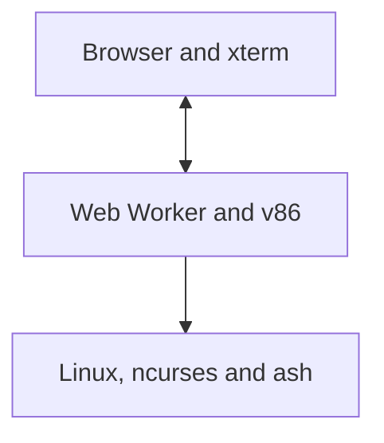
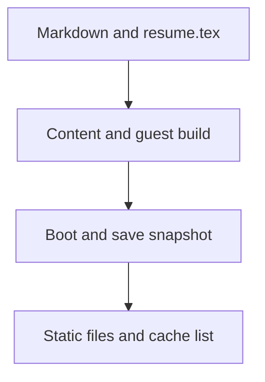
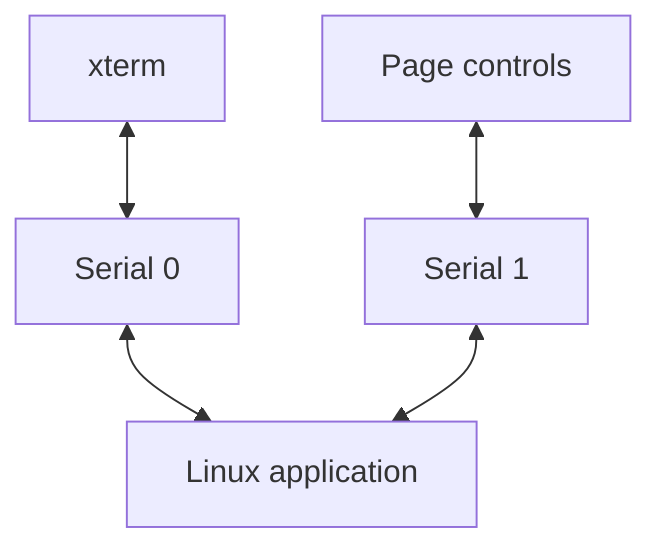
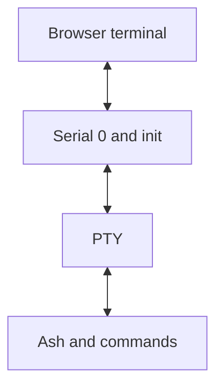
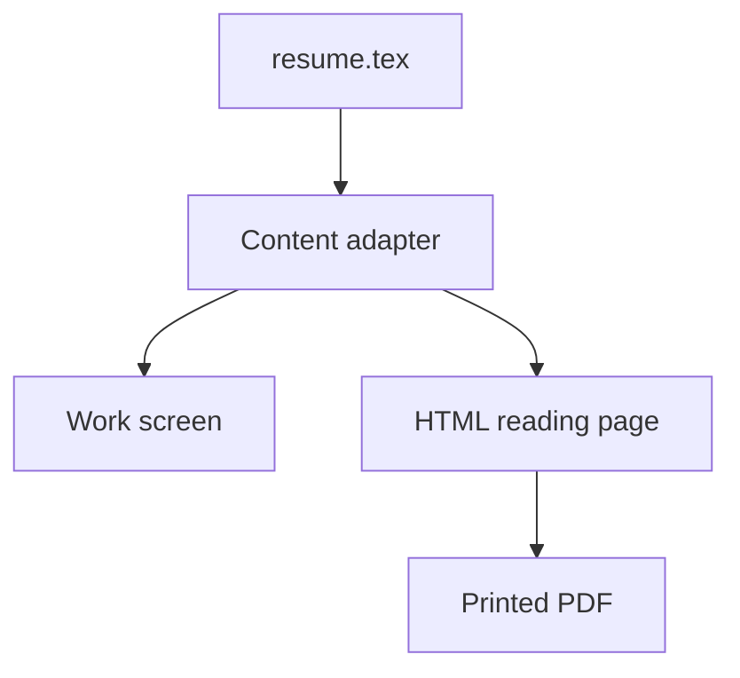
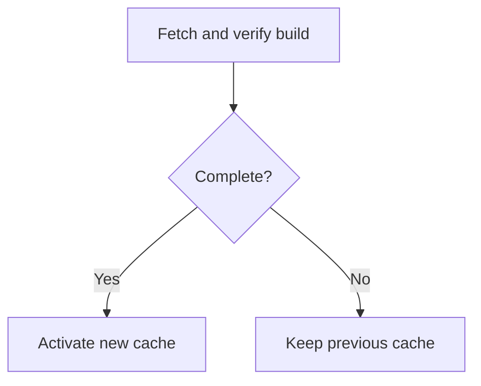

# How this site works

This website is a small Linux computer delivered as static files. The terminal is connected to a native C program running inside that computer. The shell is BusyBox ash, the process list comes from the Linux kernel, and the notes are compiled into the machine before it is published.

The browser supplies the display, keyboard, mouse, and a place to run the emulator. A static web server supplies the files. Neither needs to run a Linux instance on the visitor's behalf.

That arrangement creates an unusual boundary: publishing is conventional static-site hosting, but visiting starts a disposable operating system. This note follows the path from a Markdown file on the build machine to a page inside the terminal, then explains the shell, résumé, caching, and deployment choices.

## A computer inside a document

There are three main runtime layers. The outer HTML document contains the masthead, navigation buttons, text alternative, and résumé. xterm.js renders terminal output in that document. A dedicated Web Worker runs v86, which emulates the x86 machine executing Linux.



v86 uses WebAssembly for the emulator. It is the emulator that executes in the browser; the C application and BusyBox are ordinary i686 Linux binaries inside the emulated machine. This is why familiar Linux behavior, such as file descriptors, processes, pipes, and pseudoterminals, is available without implementing a separate imitation of each feature in JavaScript.

The worker keeps emulation outside the document's main JavaScript thread. Terminal rendering and browser controls remain in the document, communicating with the worker through messages. This is a Web Worker running locally in the browser. It is separate from both a server-side edge worker and the Service Worker used for offline caching.

The guest currently uses Linux 6.6.90, ncurses 6.5, musl 1.2.5, and BusyBox 1.38.0. Those versions are pinned build inputs. The kernel's fixed build timestamp also makes its identification reproducible; the date printed by `uname` is not the publication date of this page.

## What happens when a page loads

The HTML frame appears first, using system fonts. It identifies a content-hashed manifest belonging to that exact build. The manifest gives the browser the corresponding emulator, WebAssembly module, terminal libraries, worker, machine configuration, and guest image URLs.

The worker compiles WebAssembly while fetching the compressed machine snapshot. Once both are available, v86 restores Linux at the point where the ncurses application is already running. The browser sends the current terminal dimensions and theme, and the guest redraws itself for this display.

Readiness is tied to rendered output. The guest emits an identity message; the worker first flushes the preceding terminal bytes; and the document waits for xterm to consume them before removing the loading state. A started emulator and a visible, usable interface are different milestones.

If snapshot restoration fails, the application tries a cold boot using the kernel, initramfs, and BIOS assets. The `?cold` query parameter deliberately selects that route. It executes the boot path instead of restoring saved machine state, but arrives at the same application and content.

The machine has 128 MiB of emulated RAM. This is a runtime capacity, not a download size: v86's direct Linux loader places the external initramfs at a 64 MiB address, and the machine needs room around that arrangement. Unused zero pages are omitted from the saved state. Before saving, the build also clears free guest pages containing discarded boot data, improving compression without repeating that work on every visit.

## One Makefile, several compilers

Publishing begins with source files and ends with a `dist/` directory. The Makefile lives at the root of the `terminal-site` repository. From that directory, build the complete site with:

```sh
make build
```

From another directory, point Make at the repository:

```sh
make -C /path/to/terminal-site build
```

To list the build, preview, test, and packaging targets:

```sh
make
# Equivalent to:
make help
```



Node.js runs the content and packaging scripts. Locked npm dependencies provide the Markdown parser, Mermaid, Playwright, v86, and xterm packages. Go builds one tool: termtex, which typesets mathematics during content compilation. There is no Go application running in the browser or on the hosting server.

Docker supplies the Linux compilation environment. The builder verifies pinned source archives and cross-compiles for i686, including when the build host uses an ARM processor. The C application is linked statically against musl and wide-character ncurses. BusyBox is also built from the selected configuration, with links for its enabled applets.

The initramfs contains `/init`, BusyBox, published Markdown, generated diagram images, terminal information, device nodes, and a minimal filesystem layout. An initramfs is an initial RAM filesystem: Linux unpacks it into the guest's memory at boot. There is no persistent disk image containing personal user data.

Next, the snapshot script boots that image under v86 on the build machine. It verifies that Linux reached the expected ncurses application as PID 1, prepares the guest memory, stops execution, and saves a zstd-compressed machine snapshot. Build metadata records source and binary hashes. The web assembly step refuses stale guest inputs, so an edited note cannot silently ship beside a snapshot containing its previous version.

Compiler caches, the Go binary, diagram renders, and PDF renders are reused where possible. For browser-only changes, reuse the existing guest:

```sh
make web
```

Notes or guest C changes require the full build. To build and create a deployment archive with a SHA-256 checksum:

```sh
make package
```

## Markdown becomes terminal data

The authoring workflow is deliberately short:

```sh
# Add or edit a file under notes/, then:
make build

# Preview the generated website:
make serve
```

The note compiler recursively discovers Markdown files under `notes/`. There is no separate route registry to update. Hidden files and directories are ignored. Optional YAML front matter supplies a title, a date, or `draft: true`; drafts do not enter the guest, its `/notes` directory, or the HTML alternative. Dated notes sort newest first, with filename order breaking equal dates.

The parser uses remark with CommonMark, GitHub-flavored Markdown, front matter, and math support. It converts the syntax tree into a small set of blocks: text, headings, preformatted text, math, images, and rules. Links retain their destinations in readable text. Tables become aligned Unicode text. Raw HTML is treated as preformatted content rather than executable markup.

Those blocks produce a generated C header, JSON metadata, an HTML text alternative, image files, and a copy of each published Markdown source. The C application reads static arrays compiled into its executable. The shell sees the original sources under `/notes`, and diagram PNGs live under `/usr/share/notes`.

No Markdown parser runs when a visitor opens a note. Content interpretation happens at build time; line wrapping and pagination happen in Linux at runtime. That division keeps the reader small while allowing the same article to fit different terminal sizes.

Adding more prose or diagrams increases the guest and offline payload. Notes are part of the published machine, not fetched individually from a content API. This favors a modest personal collection and simple, complete offline availability over unlimited, independently streamed articles.

## Mathematics and diagrams take different paths

LaTeX math is passed to termtex during the build. It becomes Unicode text containing the required fractions, roots, superscripts, and other supported layouts. Inline expressions join a paragraph; display equations preserve their own rows. This is termtex's mathematical subset, not a complete TeX document engine.

For example, an idealized transfer time can be written as:

$$
T = \frac{8B}{r} + L
$$

Here, `B` is the number of transferred bytes, `r` is the link rate in bits per second, and `L` is latency in seconds. Real startup also includes parsing, compilation, decompression, scheduling, and rendering. The formula is useful chiefly for distinguishing download cost from computation and from the guest's configured RAM.

Mermaid follows an image pipeline. A build-time Chrome process loads the locally installed Mermaid library, renders a diagram to SVG, and captures a PNG fallback for the terminal. The SVG uses native vector text so it works as a standalone image. Network requests from that rendering page are blocked, so a diagram does not quietly depend on remote fonts, icons, or images. The result is cached using the source, Mermaid version, render format, and color scheme.

Each diagram gets light and dark variants. The HTML reader uses SVG by default, choosing its light or dark variant from the operating system appearance. When images are selected in ncurses, the guest chooses the light PNG for Solarized Light and the dark PNG for the other themes. `accDescr`, or `accTitle` when no description is present, supplies the diagram's text alternative. Invalid math or Mermaid fails the build with the source filename and line number.

A second renderer, beautiful-mermaid, converts supported diagrams into ASCII character grids during the same build. The guest stores that text alongside each PNG and defaults to ASCII in both the main reader and the shell pager. SVG files belong to the static HTML assets and offline cache, without adding to the Linux guest. Pressing `d`, or clicking the Diagrams button, switches between the two representations while anchoring the reader to the current diagram. The HTML reader has a separate SVG/ASCII toggle, so changing the terminal does not change the text view. Unsupported diagram families keep their image, and app screenshots always remain images. Neither diagram engine ships as browser JavaScript.

Inside the terminal, ncurses calculates the image's position and size. It emits the iTerm inline-image escape sequence, including base64 PNG data. xterm's image addon recognizes that sequence and draws the image at the selected terminal cells. Saving and restoring the cursor around the sequence keeps ncurses' cursor model consistent.

The reader knows the browser's actual cell width and height. It centers diagrams and scales images to fit the available columns and page height, and moves them to the next page if necessary instead of splitting them across pages. Ordinary paragraphs wrap using Unicode cell widths. Code, tables, and equations preserve their layout, with horizontal panning for content wider than the viewport.

Standalone Markdown images can also embed local PNG screenshots. Their paths resolve relative to the post, stay within its content directory, and participate in the build's source hashes. The terminal embeds the original image; the HTML alternative lets readers open it at full resolution. Remote and inline images retain their alt text and source location without making network requests. The HTML alternative uses ordinary picture and image elements: SVG for Mermaid diagrams and the original PNGs for screenshots.

## Two serial ports keep content and control separate

The visible terminal travels through the guest's first serial port, `/dev/ttyS0`. Keyboard input, terminal escape sequences, ncurses output, and shell output all use that byte stream. The browser does not need to infer the current page by inspecting the characters drawn on screen.



The second port, `/dev/ttyS1`, carries a compact control protocol. Browser buttons can select a section, turn a note page, resize the terminal, or apply a theme. In the other direction, newline-delimited JSON reports the kernel identity, PID, active section, selected and open note, reader pagination, theme state, and shell PID.

Keeping that protocol outside the terminal stream prevents control data from appearing at the prompt. It also allows an external page button to work while ash owns the visible terminal. Terminal output is briefly batched in the worker, reducing message overhead without waiting for entire screens.

The document tracks the identity associated with output that xterm has actually rendered. That matters for the text view and navigation controls: they should describe the visible screen, not a future state whose drawing bytes are still queued.

## The application is also init

The kernel command line uses `rdinit=/init`. Linux starts the statically linked application directly as PID 1. It mounts `/proc`, `/sys`, and `/dev/pts`, initializes the terminal, and runs the ncurses event loop. There is no desktop, display server, login manager, or separate web server inside the guest.

`guest/site.c` owns the seven sections and routes keyboard, mouse, and control-port events. `guest/reader.h` handles Notes and Projects layout, keeping a separate selection and reading position for each collection. The application sets up wide-character terminal support so Unicode equations and box-drawing characters occupy the correct cells.

Left and Right move between sections in the ncurses interface, including when Notes is selected. Up and Down choose a note, and Enter opens it. While reading, page keys and the mouse wheel turn pages; `h` and `l` pan wide content. The browser's numbered page buttons also support Left and Right when focused.

As PID 1, the application additionally starts and reaps shell processes. That small process-management responsibility is why the interface is more than a collection of painted terminal screens.

## The shell is a real terminal session

Opening Shell creates a pseudoterminal, or PTY. The parent holds its master endpoint. A child becomes a new session leader, opens the slave as its controlling terminal, attaches standard input, output, and error, and executes BusyBox ash as a login shell. It begins in `/notes`.



Ash supplies command parsing, variables, quoting, history, completion, redirection, pipelines, and job control. Up and Down recall commands. Tab completes filesystem paths. Linux creates the pipes and processes behind a command such as:

```sh
find /notes -name '*.md' | sort
```

BusyBox is a multicall executable: many familiar command names link to one binary, which chooses an applet based on the invoked name. `ls`, `find`, `cat`, `ps`, `free`, `uname`, and `top` work on the guest's actual filesystem and process state. `top` reports this small Linux machine, not the host operating system or every process in the browser. The `?` command lists the available applets, built-ins, and site-specific commands.

`view` is a site-specific entry point linked to `/init`. When invoked with a published note path, that executable enters a standalone ncurses pager instead of starting another copy of the site interface. It uses the same compiled blocks, termtex output, and diagrams as Notes and Projects. Published project Markdown lives in `/projects`, so `view /projects/ac-man.md` opens the project post in the same pager. Quitting returns to ash with Shell still selected. When standard input or output is not a terminal, `view` prints the note's block text, making it useful in pipelines too.

Switching to another section keeps the shell and its state. The application stops the shell and its foreground process group while hidden, restores ncurses, and resumes them when Shell returns. The browser's terminal buffers preserve the display. An unfinished command, variables, working directory, and files remain available.

Writes to `/dev/console` are redirected through the same PTY as shell output. This gives command echo and console output a shared ordered path and consistent terminal newline processing. BusyBox `echo` in this configuration prints backslash sequences literally; `printf 'hello\n'` is the explicit way to produce an escaped newline.

The shell runs as root inside the disposable guest. Its files are guest files in memory. It has no mount of the host filesystem and no external network adapter.

## A narrow bridge for the public IP command

`ip a` is the one optional operation that asks an external service for information. A small wrapper requests a lookup through a local Unix socket. PID 1 forwards that request over the control serial port, and the browser worker makes an HTTPS request to ipify. It sends neither cookies nor a referrer.

The returned address is validated and assigned to a dummy interface named `public0` inside Linux. The wrapper then invokes the native BusyBox `ip` applet. The resulting output is Linux's own interface output, so pipes and redirection behave normally.

The `/32` IPv4 or `/128` IPv6 prefix belongs to this virtual interface. It does not describe the visitor's LAN, router configuration, or host interfaces. `busybox ip a` bypasses the lookup and inspects only the guest's existing interface state.

This bridge does not provide general guest internet access. It is an explicit, fixed-purpose browser request with validation and a timeout. Offline or blocked lookups return a command error; they do not prevent the site, notes, or shell from starting.

## A résumé can have a different reading surface

The résumé source lives in `misc/resume.tex`. A constrained adapter understands its section, role, item, and formatting macros and extracts structured content. It produces a native Work overview, an HTML reading page, and data for the PDF. Unsupported content commands fail the build rather than disappearing silently.



Only the selected name and email leave the contact table. The original source, phone number, and postal address are not copied into the deployed site or guest. The PDF is generated from the HTML and print stylesheet using build-time Chrome, preserving selectable text. It does not require a TeX installation or a PDF renderer in the Linux guest.

Opening the résumé from the terminal changes the URL and visible view within the same document. The worker and terminal stay mounted; the emulator pauses while the reading page is visible. Returning through a link or browser history resumes the existing machine, including its shell history, files, and unfinished input.

A direct visit to `resume.html` serves a standalone HTML document and does not need to boot Linux. A reload or explicit Restart, by contrast, starts a new disposable guest session.

## Themes and an ordinary text alternative

The default theme follows the operating system's light or dark preference, choosing Solarized Light or Solarized Dark. Manual Solarized, Nord, Dracula, and Gruvbox choices are saved in browser storage. Pressing `t` on System opens the guest's chooser; the selected theme updates both xterm's palette and the surrounding document.

The outer page remains near black so the terminal has a clear visual boundary. The terminal and text reading area use their own theme backgrounds and share the same width.

Read as text follows the current section. Notes and Projects display either the index or the one open article, while System and Shell expose the current terminal text. Closing it returns focus to the toggle. The generated articles already exist in HTML, so a visitor without JavaScript can still read the static content and résumé. In that case there is no running terminal state to select a current section, so the static fallback exposes the available content together.

## Caching the complete build

Ordinary HTTP caching helps repeat visits, but the site also installs a Service Worker to retain the complete published build in browser Cache Storage. The build generates its file inventory, including the HTML entries, hashed manifest, terminal and emulator code, saved state, cold-boot assets, note images, résumé PDF, and license files.



Fetched files carry SHA-256 integrity checks. An incomplete deployment fails installation and leaves the prior complete cache active. Immutable assets already present in an older cache can be reused. Compression sidecars are omitted from the inventory because `.br` and `.gz` transport variants are not separate application resources; the compressed initramfs itself is still included.

After activation, requests for the known site resources are served from the cache first. The current and preceding builds are retained so an already open document can still request its matching hashed assets. Entry HTML pins its manifest instead of combining an older page with a newly published asset list.

New builds install in the background without automatically reloading the running VM. Subsequent navigation can use the new cached entry page. Restart attempts an update check, with a bounded wait, before explicitly starting a fresh session.

The complete offline cache is larger than the normal startup transfer. It includes fallback boot files, the PDF, and images that a visitor may never open. That extra background download buys independence from the network after installation completes.

Cached publication files and live machine state are separate things. Cache Storage does not save the visitor's evolving guest RAM, shell history, or temporary files. A reload restores the shipped initial snapshot. Themes have their own small browser preference, but guest persistence is not implemented.

Service Workers require HTTPS, with a development exception for loopback addresses such as localhost. Browsers may evict cached storage under pressure, and clearing site data removes it. If registration or storage is unavailable, the website still loads normally from its static host. Offline availability begins only after the complete cache has installed successfully.

## Serving it from any static host

The deployment artifact is `dist/`. It can be served by a conventional web server, object storage, or a CDN. There is no server-side application, database, login service, or required edge function. Node, Go, Docker, and Chrome are tools used before publication.

Assets receive content-hashed filenames and long-lived immutable cache headers. HTML and the Service Worker script revalidate so a later deployment can be discovered. The build supplies Brotli and gzip variants for assets that benefit from HTTP compression; the host must negotiate and label those responses correctly.

The saved machine state already uses zstd compression. v86 decodes it as an application file, so it is served as ordinary binary data without an HTTP `Content-Encoding: zstd` header. WebAssembly is served as `application/wasm`, enabling streaming compilation.

Download bytes, offline storage, and runtime memory answer different questions. A normal visit primarily needs the snapshot and terminal/emulator assets. A cold boot needs another set of assets. The complete cache retains both paths plus the reading documents. The build reports these sizes so they can be measured for the actual published content instead of inferred from the guest's 128 MiB RAM setting.

## Verifying the seams

The tests exercise the boundaries where these layers meet: Markdown discovery and errors, Unicode math, diagram images, responsive pagination, keyboard and mouse navigation, theme persistence, snapshot recovery, and the standalone résumé.

Shell tests run actual guest commands to check history, completion, pipelines, `find`, `view`, `top`, and session preservation. Public-IP tests use controlled responses for address families, errors, cancellation, and timeouts. Offline tests check complete caching and subsequent loads without a network connection.

Performance measurements distinguish navigation-to-rendered-output from VM startup after the terminal dependencies are ready. They cover fresh and cached snapshot loads, cold boots, and a constrained connection. Those distinctions keep a quick local restore from being mistaken for a universal loading guarantee.

The result is a site whose published artifact remains a directory of files, while its main interface has the behavior of a small operating system. Adding this article required one Markdown file and another build; reading it can happen through ncurses, the shell's `view` command, or ordinary HTML, all generated from that same source.
