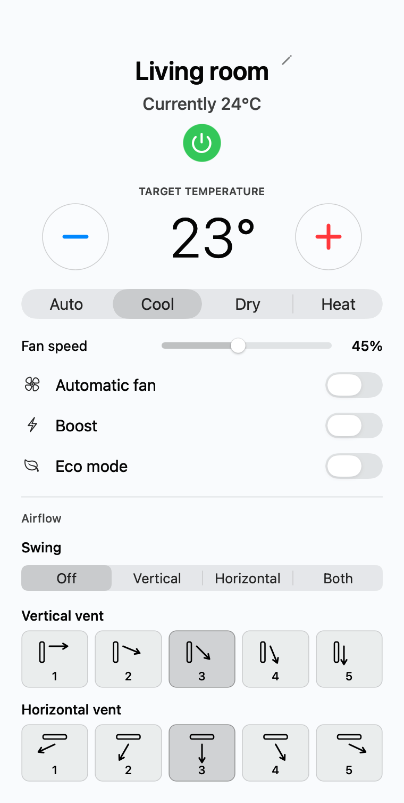
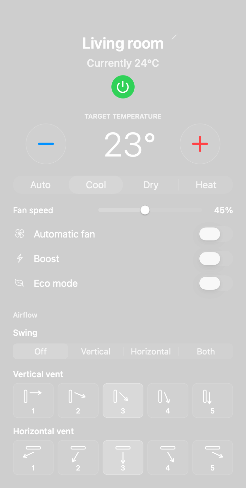
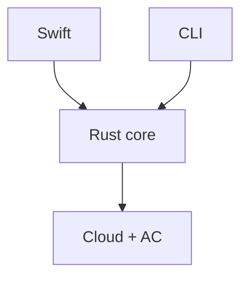
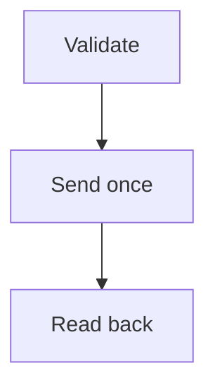
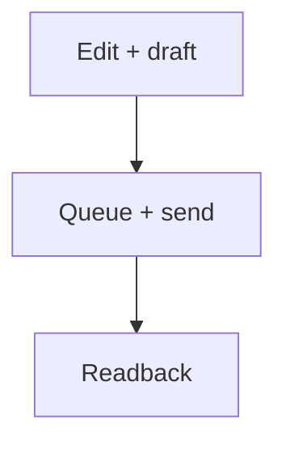
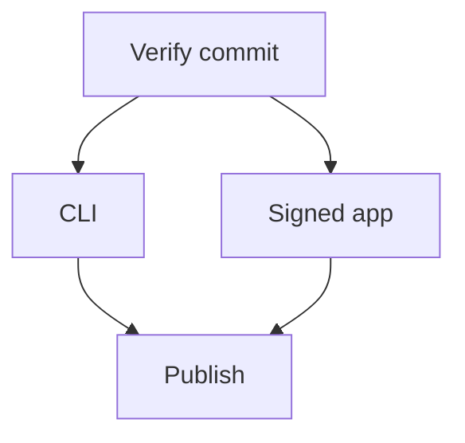

# Engineering ac-man

ac-man brings Midea air-conditioner controls to a native macOS menu-bar application and a command-line tool. Both interfaces use the same asynchronous Rust controller, communicating through the SmartHome cloud. [Source code and releases on GitHub](https://github.com/bootstrap314/ac-man).

The interesting engineering problem is not drawing a temperature control. It is preserving the meaning of that control across a native interface, an asynchronous service, a binary device protocol, and hardware whose supported settings vary by model. A button press expresses intent; the appliance's later response is evidence about what happened. Those are separate pieces of information.

The design keeps protocol and command decisions in one core, treats device capabilities as input, and makes uncertain results visible. It also keeps installation independent of the development environment: the finished app loads its Rust library directly, without Python, a local web server, or Home Assistant.

## The native app

The menu-bar panel keeps the current temperature, target, operating mode, fan controls, and airflow settings together. These screenshots show the actual native controls in light and dark appearances with example room data. The available controls depend on the selected unit's capabilities.

## One controller, two interfaces

The Rust library exports an `AcController` with operations for login, discovery, snapshots, status reads, settings changes, and local labels. The CLI calls those operations directly. BoltFFI generates the bindings that let Swift call the same asynchronous methods.

The boundary carries structured data rather than formatted terminal output. `DeviceSnapshot` includes current values, freshness information, errors, and supported choices. `SettingsChange` contains optional fields: an absent temperature means leave it unchanged, while an explicit value requests a change. The native app never needs to parse the CLI's printed messages.

This keeps validation consistent. A temperature selected in Swift and one supplied to `ac-man 1 temperature 23.5` reach the same capability checks and confirmation logic. The CLI adds its own concerns: readable command syntax, machine-readable JSON, and nonzero exit statuses for failures. The app adds presentation, focus, pending-state feedback, and input coalescing.

Rust runs controller work on a shared Tokio runtime. Its state sits behind an asynchronous mutex, while shared on-disk operations also use a cross-process lock. Two interfaces can therefore use one inventory without racing to rewrite its settings. Credential-store operations use blocking tasks rather than occupying an async executor thread with an operating-system keyring call.

## Separate the cloud envelope from the appliance protocol

`cloud.rs` handles authentication, regional service routing, session headers, account inventory, and the transparent command relay. `protocol.rs` understands AC frames: capabilities, state, checksums, and settings encoding. The controller composes those pieces into user operations.

The cloud relay carries encrypted appliance commands. The implementation translates frame bytes into the service's signed-byte representation, encrypts the payload with session material, and reverses that process for replies. An HTTP success alone does not make a reply useful: its result code, payload encoding, envelope, frame length, and device-level checksums still need validation.

This separation also distinguishes two kinds of failure. A rejected login is a service problem; a truncated AC status frame is a protocol problem. The user receives controlled error messages rather than arbitrary server text, which could contain sensitive details. HTTPS destinations are restricted, redirects are disabled, and responses have a size limit.

The path is cloud control, not local-network discovery. The computer needs internet access and the AC must be online, but they do not have to share Wi-Fi. That convenience comes with a dependency on the vendor service's availability and behavior.

## Capabilities are part of the interface contract

A generic AC panel can easily offer controls that a particular unit cannot perform. ac-man queries capability frames and uses their decoded values to build mode, fan, swing, and vent choices. The same capability object validates outgoing changes.

Temperature input must be finite, fall on a half-degree Celsius step, and fit the decoded range. A custom-fan unit can accept whole percentages from 1 through 100. A fixed-speed unit accepts only the supported values represented by its capability mapping. Automatic fan is a separate protocol value, not a percentage above 100.

Vent positions are another important distinction. The interface presents indexed positions, while the wire protocol uses values such as `1`, `25`, `50`, `75`, and `100`. Those numbers are not measured angles in degrees. An unknown reported position remains unknown; the app does not display it as a confidently selected Off button.

Some devices advertise an additional capability page. If that optional page is missing, the controller retains first-page controls and tries the extra page again on later reads instead of permanently caching the absence. Optional vent-property queries also do not disable basic controls when firmware fails to answer them.

Capability support is still an interpretation of a particular protocol family. The decoder includes defaults for certain omitted fields, including a fallback temperature range. Those are compatibility assumptions in the implementation, not evidence that every Midea model supports the same behavior. An advertised feature, a recognized frame, and verified operation on a real unit are distinct levels of confidence.

## A write is not complete when it is sent

Changing settings begins with a fresh device read. The controller validates the requested fields against capabilities and applies them to that state before encoding a command. This preserves fields the user did not ask to change.

After sending, the controller waits briefly and reads the device again. It compares the returned values with the fields in the request, allowing up to three confirmation reads with delays. An acknowledgement without an immediate device reply can be followed by this same status check.

If the result cannot be confirmed, the controller removes the cached state for that device and records an error. The interface should not continue showing an optimistic setting as though the hardware had verified it. The next useful action is a refresh and inspection of the unit's actual state.

The controller does not automatically repeat an uncertain write. A lost acknowledgement can mean either that the change failed or that it succeeded and the reply was lost. Reissuing it invisibly would turn a communication failure into another physical action. Read-only session recovery and confirmation reads have different semantics from retrying a mutation.

Some combined changes require a regular settings frame and a separate vent-property frame. They are not a transaction with rollback: one frame could apply before the other fails. Reporting uncertainty is therefore more accurate than promising all-or-nothing behavior. Even a successful readback confirms reported settings, not an independent measurement of cooling performance or mechanical vent position.

## Responsive controls without a request storm

The Swift application uses native AppKit controls on the main actor. Calls into Rust are awaited asynchronously, keeping network waits outside the UI thread. The display can react to a click immediately while still distinguishing a pending intention from a confirmed snapshot.

Temperature buttons update a draft in half-degree steps and wait 500 milliseconds after the latest adjustment before sending. Repeated presses can become one final temperature request. The fan slider previews a percentage while dragging and commits through its control event rather than sending every intermediate pointer position.

Each device has pending and queued changes. If another request is already running, newer input is merged into the next request: the latest value wins for the same field, and different fields can be combined. A failed request is not retried by that queue; only newer explicit input is eligible to go next.

Automatic fan, Boost, and Eco have deliberate interaction rules in the native app. Enabling one clears the competing settings in the same logical change. Boost or Eco restores a supported manual fan value; the slider is disabled while Automatic fan or Boost is active. Turning a toggle off does not arbitrarily enable another mode. This mutual-exclusion policy belongs to the native interaction design; it is not a claim that every physical model implements an identical internal state machine.

Whole-inventory refreshes also need scheduling discipline. The Rust controller reads devices sequentially, but releases both locks between units and yields so a queued command can run. A session revision detects an intervening login or logout and stops an obsolete refresh from continuing through the old inventory. The final snapshot is built from current shared state so it does not overwrite a command that ran between reads.

## Stable device identity and private local state

Cloud discovery imports the air conditioners available to the signed-in account. The application assigns stable positive local integer IDs, preserves existing assignments across discovery, and lets the user change local labels or IDs. There is no built-in household inventory or fixed device count.

The distinction between cloud identity and local presentation matters. A label is convenient for people, but duplicate imported names can be ambiguous; the CLI then requires an integer ID. Renaming a local room does not rename it in the phone app. Listing cached devices, renaming them, and assigning IDs can work offline because those are local operations.

The app and CLI share the default application-data directory. It contains inventory, labels, IDs, a stable client identity, and status diagnostics. New Unix files use owner-only permissions, and the directory is protected as well. JSON writes go through a temporary file, a sync, and rename, reducing the chance of leaving a partially written settings file.

Passwords and reusable cloud-session material take a different route: macOS Keychain or the Linux user's Secret Service keyring. There is no plaintext password-file fallback. The native app can also retain a login only in memory when its remember option is disabled. Local metadata remains private even without passwords; device names and diagnostics are not appropriate contents for a public source archive.

The CLI prompts for a hidden password rather than accepting a `--password` argument. Automation can provide one line through standard input. This avoids requiring a secret in shell history or the process argument list. Selecting another data directory changes local storage, but does not create an independent account in the OS credential store.

## Testing without operating an air conditioner

Protocol tests use synthetic fixtures and reference vectors. They check command bytes, decoded state, capability choices, temperature and fan validation, malformed lengths, checksums, Eco behavior, and vent positions. Their purpose is to make the wire-format interpretation reproducible without requiring a signed-in account or issuing commands to real equipment.

Cloud tests queue synthetic HTTP responses and inspect the requests the client constructs. They exercise signatures, password hashing, regional routing, session headers, discovery filtering, encrypted commands and replies, missing acknowledgements, result-code handling, and response-size limits. A service error must retain its classification without reflecting sensitive response text into the UI.

Controller tests target concurrency as well as data. One deliberately queues a command while a refresh holds its locks, then verifies that both locks are released between devices and the intervening change survives. Another changes the session during refresh and verifies that the remaining old-session reads are cancelled.

Native control tests inspect actual AppKit controls without sending AC commands. They check that unsupported positions are absent, disabled buttons cannot send actions, reserved fan codes are not displayed as percentages, and refreshing preserves button identity and keyboard focus.

These tests establish behavior for the modeled inputs. They do not prove compatibility with all hardware, real TLS behavior, every timeout scenario, or the network-interface fallback. Those require separate transport integration checks and controlled testing with specific devices. Keeping that boundary explicit makes the fixture suite useful without overstating what it demonstrates.

## Packaging is another engineering boundary

The app is built from generated BoltFFI bindings and native Swift code. The current menu-bar target is Apple Silicon with macOS 13 or later. CLI archives cover Apple Silicon, Intel macOS, and Linux x86_64; the Linux release build uses a defined glibc baseline. Users of those artifacts do not need Rust or Swift installed.

Publishing is a manually dispatched workflow, not a side effect of pushing any tag. It resolves the chosen tag to a commit, runs verification, and checks that the tag has not moved before publishing. The verification job's unsigned app archive is the input to the signing job, avoiding an unrelated rebuild between those stages.

The macOS app and DMG are Developer ID signed, submitted for Apple notarization, and stapled before release. A failure blocks publication. Local development builds are ad hoc signed, and the separate CLI archives do not pass through the app-signing job. Those distinctions are part of the artifact contract, not interchangeable assurances.

Release outputs include checksums, source identity, and generated dependency-license notices. Cargo Audit and Trivy provide dependency and packaging checks, while Rust formatting, Clippy, tests, and platform builds verify other properties. None is a substitute for application-level tests or hardware compatibility evidence. Account data is never a packaging input.

ac-man's central design choice is to give every layer a clear responsibility: native controls express intent, Rust validates and schedules it, the protocol encodes it, and readback supplies evidence of the result. That structure makes a small menu-bar utility useful from both a mouse and a shell while keeping device differences, network delays, and uncertain outcomes visible.
