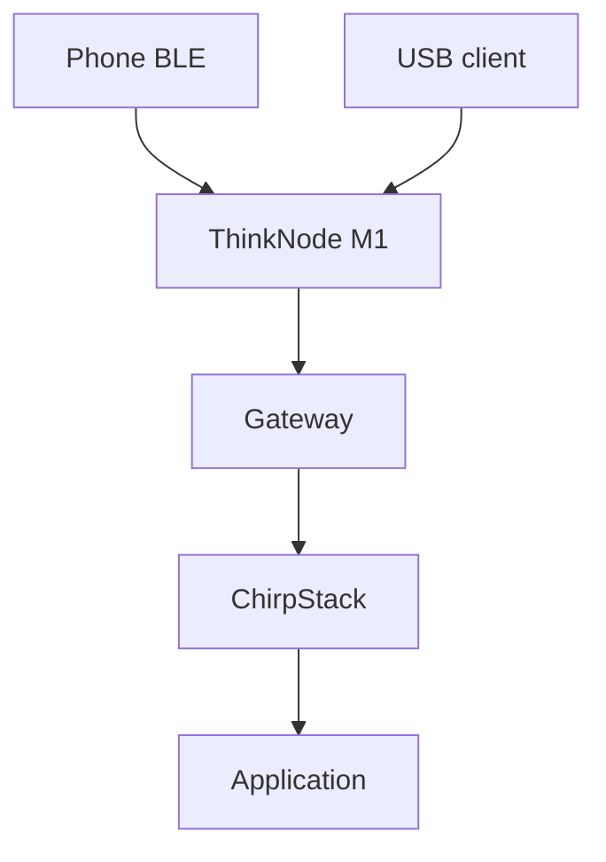
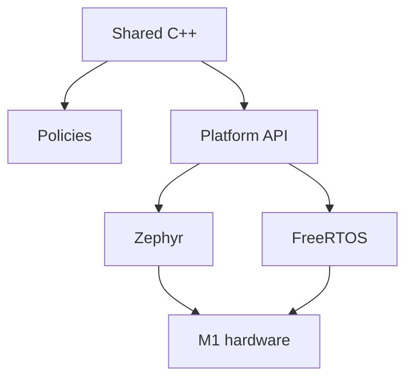

# Rebuilding the ThinkNode M1 firmware

The Elecrow ThinkNode M1 puts an nRF52840 microcontroller, an SX1262 radio, an L76K GPS receiver, and a 200 × 200 e-paper display into a handheld device. This project replaces its original Meshtastic application with native firmware for a LoRaWAN tracker, messenger, and USB dongle. The same shared C++ application builds for either Zephyr or FreeRTOS.

[Explore the firmware on GitHub](https://github.com/bootstrap314/thinknode_m1-infovore). This is a preview project: local USB and authenticated iPhone Bluetooth operation have been exercised on hardware, while actual LoRaWAN delivery, outdoor GPS acquisition, endurance, and current consumption remain to be validated. The distinction matters throughout the design.

## A different job for the same hardware

In tracker mode, the application schedules GPS samples and position uplinks when joined to a network. Dongle mode pauses automatic position uplinks and initially puts GPS into standby, leaving USB, Bluetooth, and the display available. A computer can issue commands over USB; a phone can use the Nordic UART Service through Bluefruit Connect. Both modes run the same firmware and command engine.

The target network is AU915 sub-band 2 with OTAA and a private ChirpStack deployment. This is a LoRaWAN end device, not a gateway or a Meshtastic/MeshCore node. It sends through a LoRaWAN gateway; it does not receive nearby sensors' uplinks directly or establish an IP connection to ChirpStack.



Class A operation constrains what “messaging” means. Downlink receive windows follow an uplink; the device is not a continuously listening remote terminal. A service that routes messages to other devices must account for those windows and LoRaWAN's small, intermittent payloads. Local status streaming over USB or Bluetooth is separate and does not generate radio traffic.

## One application, two native operating systems

The shared application, output formatter, screen layout, and display driver compile against a platform interface. RadioLib connects to native GPIO, SPI, interrupts, and timing through its generic hardware abstraction. Portable policies handle commands, GPS validation, buttons, power scheduling, and persistent state.



Zephyr uses a custom board definition and its native drivers, Bluetooth stack, settings storage, and USB CDC ACM implementation. FreeRTOS uses the Nordic SDK and the installed S140 SoftDevice, with separate application, Bluetooth, and USB tasks and an RTC-based tickless port. Neither target depends on Arduino or the Bluefruit firmware library. Compatibility with the Bluefruit phone app comes from implementing the service it speaks.

RTOS selection is a build-time choice, not dual boot. The two adapters share application behavior but have different startup, interrupt, storage, and peripheral requirements. Keeping those differences behind a small interface makes the portable parts testable without pretending the operating systems are interchangeable.

## Keep the bootloader, partition the state

Application-only updates preserve the installed bootloader and SoftDevice. The native application occupies flash from `0x26000` to `0xE5000`, with a maximum size of 764 KiB. A two-page journal follows it. Zephyr and FreeRTOS have separate Bluetooth bond regions, and the remaining reserved storage and bootloader space stay outside the application image.

That memory map is a compatibility contract with the inspected M1 bootloader, not a universal nRF52840 layout. Packaging checks reject images that enter protected regions or disagree across ELF, HEX, UF2, and serial DFU representations. Switching native RTOS builds preserves the shared credentials and LoRaWAN state, but does not migrate Bluetooth bonds between stacks. A phone may need to forget an old bond and pair again.

LoRaWAN state needs stronger treatment than an ordinary settings file. Reusing a join nonce or rolling an uplink counter backward after a power cut can break protocol security and server replay checks. Before joining or transmitting, the implementation reserves future state in flash; successful exchanges then save the actual state.

The journal writes the inactive page, verifies it, and commits its magic word last. Until that commit, the previous complete snapshot remains available. If persistence fails, further radio use is disabled. This trades availability for a clear invariant: transmission must not proceed on state the device cannot safely preserve. Host tests interrupt writes at each stage and exercise reservation carries and exhaustion.

## Two transports, one command model

USB and authenticated Bluetooth feed separate bounded parsers into the shared application loop. Commands run serially, while each transport owns its own status-stream subscription. Disconnecting a transport stops its subscription. An overflowing or fragmented command must not leave the next command misaligned.

For a phone, the useful interface is short, labelled text:

```text
status;
mode dongle;
stream 5;
stream off;
gps now;
```

USB retains single-line `STATUS protocol=1` records for programs to parse. The Python client turns those records into JSON lines and handles interleaved events. Human-readable Bluetooth formatting can therefore improve without silently breaking the computer-facing protocol.

```sh
python scripts/m1.py ports
python scripts/m1.py --port /dev/cu.usbmodemXXXX status
python scripts/m1.py --port /dev/cu.usbmodemXXXX monitor --interval 5
```

The port above is a placeholder; use the one reported by `ports`. Local controls work before the device has joined LoRaWAN. Radio sends require provisioned credentials and a joined session. Release images contain no private LoRaWAN keys; provisioning happens separately over authenticated Bluetooth or local USB, without echoing the key.

## Make e-paper readable without constant flashing

E-paper is persistent, slow to refresh, and very different from a desktop framebuffer. The driver compares frames, skips identical content, and updates changed byte-aligned regions through the SSD1681 controller. A full refresh happens at startup or explicit cleanup; ordinary changes use partial updates and synchronize the controller's baseline before powering the panel down.

The screen uses 16-pixel text and three information pages instead of packing every field into one tiny dashboard. Pairing codes use 24-pixel text. Layout tests cover extreme coordinates, counters, and error values, checking that text stays within the panel and does not overlap. Driver tests use a fake SPI/GPIO backend to inspect the actual writes, including erasing old text.

Button behavior is also a state machine. A tap and a hold must not both fire, overlapping presses must suppress individual actions, and waking a blank display must consume that first press. Holding both buttons blanks the screen and disables the light, while background updates leave it blank. This does not shut down the device: the rotary switch still controls power.

Partial updates can leave ghosting, so a correct framebuffer diff is only part of the problem. Long-term appearance and temperature behavior still need physical assessment.

## Power is a policy to measure

GPS sampling, standby, radio sleep, display sleep, idle CPU sleep, and a 60-second backlight timeout are explicit policies. The physical GPS switch takes precedence over software. Tracker mode schedules sampling; dongle mode pauses automatic tracking while allowing an explicit local fix request. Mode selection is volatile and returns to tracker mode after reboot.

Host simulations check schedules, timeouts, and timer rollover. They report awake time, not battery life. Real consumption depends on peripherals, radio timing, Bluetooth connections, and the board itself. Likewise, local stream intervals are scheduling targets: screen refreshes and radio operations can delay the application loop.

## Hardware finds what a passing build misses

The first Zephyr hardware run exposed a USB startup edge case: the bootloader could consume the cable-insertion event before the application started. Checking the current VBUS level as well as later events fixed enumeration without requiring a cable replug. Battery reporting also needed the correct Zephyr analog-channel identifier.

FreeRTOS exposed a different set of integration problems. The Nordic power driver needed initialization before enabling the SoftDevice. The ADC DMA buffer needed alignment and volatile access so optimized code observed the hardware-written sample. An iPhone could see the Bluetooth advertisement but could not connect until the adapter answered data-length and PHY-update requests.

These were runtime problems in code that compiled successfully. The corrected local FreeRTOS images passed 13 USB checks and operator-confirmed phone pairing, commands, streaming, and reconnection. The fixes are included in `v0.1.0-rc.2`; the earlier release assets remain unchanged. Local hardware checks and separately built release binaries are recorded distinctly rather than treated as identical evidence.

## Verification is part of the build

Portable C++ tests run with warnings as errors and address/undefined-behavior sanitizers. The suite exercises parser recovery, button gestures, GPS validity, journal recovery, transport formatting, display writes, payload decoding, and package boundaries. Cross-builds then establish that both native targets compile and produce consistent application-only artifacts.

From a prepared repository environment:

```sh
python scripts/verify.py
python scripts/verify.py --build --rtos all
```

The supported flashing path runs its verification gate before accessing USB. Packaging records dependencies, checksums, and a source fingerprint; a build that changes underneath verification cannot reuse stale evidence. CI builds both targets, and the manual release workflow prepares a draft from an existing version tag for review.

As of this post, end-to-end LoRaWAN join/uplink/downlink delivery, outdoor GPS fixes, long-duration operation, and measured current consumption remain open work. Release manifests retain `hardware_validated: false`. The result so far is a functioning local control surface and a tested firmware foundation, with field acceptance kept separate from compiler and host-test success.

## Further reading

- [Source and current project status](https://github.com/bootstrap314/thinknode_m1-infovore)
- [Native architecture and memory map](https://github.com/bootstrap314/thinknode_m1-infovore/blob/main/docs/ARCHITECTURE.md)
- [Hardware observations and remaining validation](https://github.com/bootstrap314/thinknode_m1-infovore/blob/main/docs/HARDWARE_TESTING.md)
- [Verification scope](https://github.com/bootstrap314/thinknode_m1-infovore/blob/main/docs/VERIFY.md)
- [Firmware releases](https://github.com/bootstrap314/thinknode_m1-infovore/releases)
